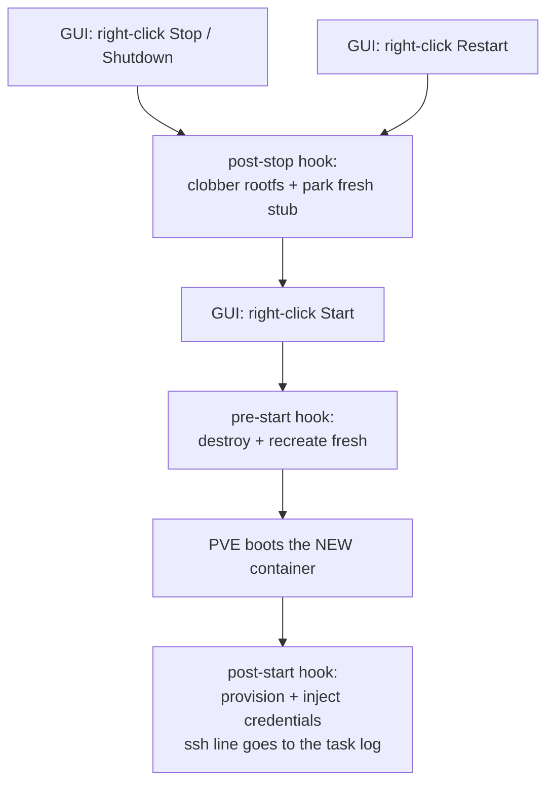

# mistral-sandbox

A single-use, auto-rebuild Linux container (LXC) sandbox for Proxmox VE,
provisioned on every build with the current
[Mistral Vibe CLI](https://docs.mistral.ai/vibe/code/cli/install-setup).
A contained environment for letting an AI coding agent work with full
outbound internet access — without handing it your machine.

## Design

- **Single use** — one sandbox at a time (fixed CTID); nothing persists
  between uses.
- **Auto rebuild on startup** — `up` (or a GUI Start) never resumes an old
  container: it destroys any existing one and rebuilds from the template,
  so every session starts clean.
- **Serially rebuildable** — a global `flock` serializes operations and the
  build is deterministic from the config block; rebuild #1 == rebuild #50.
- **Internet-enabled** — unrestricted outbound net: the agent can download
  any tool it needs (apt, curl, pip, uv, npm) and search or fetch the web
  whenever required (the Vibe CLI also has web search and fetch built in).
- **Mistral-tooled** — the current Vibe CLI (`mistral-vibe`) is installed
  at build time, unpinned, so each rebuild gets the latest iteration.
- **Credential store** — a host-side key file is re-injected into every
  rebuild; the key is created and revocable at chat.mistral.ai
  (Code > Vibe CLI) and never lives in this repository.
- **SSH-kept** — a dedicated sandbox keypair is permanently retained on the
  host (default `/root/.vibe-sandbox-ssh`), generated automatically on the
  first `up`, and its public half is injected into every rebuild. The
  private key stays on the host; override with `SSH_PUBKEY` to reuse an
  existing key instead.
- **GUI-trapped** — the Proxmox GUI drives the lifecycle: right-click
  Start = fresh rebuild + provisioning; Stop = disk clobber + parked stub;
  Restart = fresh rebuild. Implemented with a `pct` hookscript, whose shim
  is auto-deployed on every run. `HOOK=off` disables it.
- **Clobbered** — on stop, the rootfs is discarded (`CLOBBER=discard`,
  instant on SSD) or zero-filled (`CLOBBER=zero`, overwrite-grade) and the
  CT is replaced by a pristine, unprovisioned stopped stub: the GUI keeps a
  Start-able object while the stopped sandbox holds nothing from the
  previous session. `CLOBBER=off` skips the wipe.

## Requirements

- Proxmox VE 8.x; run on the host as root (uses `pct` / `pveam` / `pvesm`).
- A bridge with DHCP (default `vmbr0`).
- A storage pool for the rootfs (default `local-lvm`).
- Internet access from the host (the build downloads the container
  template, the toolchain, and the Vibe CLI).
- No SSH key needed in advance: the script generates a dedicated keypair on
  the first `up` and retains it at `/root/.vibe-sandbox-ssh`.

## Quick start (step by step)

Every command below runs in a root shell on the Proxmox VE host itself.
Open the host console or SSH into it, then:

```bash
sudo -i
```

### 1. Download the script to the host

```bash
curl -fsSL https://raw.githubusercontent.com/itsfja/mistral-sandbox/main/vibe-sandbox.sh -o /root/vibe-sandbox.sh
chmod +x /root/vibe-sandbox.sh
```

Check it landed and works — this prints the built-in help, nothing else:

```bash
ls -l /root/vibe-sandbox.sh    # must show -rwx... (an x in the permissions)
/root/vibe-sandbox.sh          # prints usage; no side effects
```

Prefer git? `git clone https://github.com/itsfja/mistral-sandbox.git`
and use the script from the checkout; every later step is identical.

### 2. Add your Mistral API key (one time)

Create a key at chat.mistral.ai (Code > Vibe CLI), then store it on the
host — replacing `paste_your_key_here` with the real key:

```bash
printf 'MISTRAL_API_KEY=paste_your_key_here\n' > /root/.vibe-sandbox.env
chmod 600 /root/.vibe-sandbox.env
```

Check it — exactly one line starting with `MISTRAL_API_KEY=`:

```bash
cat /root/.vibe-sandbox.env
```

Never paste the real key anywhere except this file — not into issues, PRs,
chats, or screenshots. If you skip this step entirely, builds still work,
but the first `vibe` launch inside the sandbox will fall back to an
interactive sign-in.

### 3. Check two host settings (two minutes)

```bash
pct list       # CT 1042 must not already exist; if it does, pick another: CTID=1043
pvesm status   # find your rootfs storage name; default expected: local-lvm
```

If your storage or network bridge differ from the defaults, pass them on
the command line (with every command you run):

```bash
STORAGE=my-pool BRIDGE=vmbr1 /root/vibe-sandbox.sh up
```

### 4. Build the sandbox

```bash
/root/vibe-sandbox.sh up
```

The first run downloads the container template, generates the retained
SSH keypair, provisions the toolchain and Vibe CLI, and auto-deploys the
GUI hookscript shim — expect a few minutes. It ends with `sandbox ready.`
followed by the ssh line. If you do not see both lines, it failed: read the
message above them and check Troubleshooting below.

### 5. Get inside

```bash
ssh -i /root/.vibe-sandbox-ssh root@$(/root/vibe-sandbox.sh ip)
```

The IP is the one `up` printed; `/root/vibe-sandbox.sh ip` shows it again
any time. Once inside, confirm the tooling:

```bash
vibe --version    # the CLI is installed
vibe              # start a session; /whoami shows which credentials are in use
```

### 6. When you are done

```bash
/root/vibe-sandbox.sh down
```

The disk is clobbered and the sandbox is parked as a fresh, stopped stub:
nothing from your session is recoverable from it. Your API key store and
SSH keypair stay on the host. The next session is either `up` again, or
just right-click Start on the stub in the Proxmox GUI. To remove the CT
from the tree entirely, use `purge` instead.

## GUI-driven lifecycle (Proxmox right-click)

With `HOOK=on` (the default), the sandbox CT carries a `pct` hookscript, so
the Proxmox GUI becomes the front end:



| GUI action | What actually happens |
| --- | --- |
| Start | fresh rebuild from template, then provisioning; the Start task stays busy until provisioning finishes — open its log for the `ssh -i ...` line |
| Stop / Shutdown | rootfs clobbered (`CLOBBER`), CT replaced by a pristine stopped stub; the GUI keeps a Start-able object holding nothing from the session |
| Restart | stop phases, then start phases: a fresh rebuild |
| Snapshot / Clone / Migrate / Backup / Console | **not trappable** (no hook phase) — harmless, since the next Start purges everything, but they cannot be blocked per-CT |

Honest caveats:

- **Test on your PVE build first.** The pre-start hook recreates the CT
  while PVE is mid-Start on the same vmid. It works because the recreated
  config and disk volid are identical (same vmid, same storage), but it is
  the piece most sensitive to PVE updates.
- **Clobber levels.** `discard` is instant on SSDs and defeats casual and
  software-level recovery, but relies on the drive honoring TRIM — it is
  not guaranteed against chip-level forensics. `zero` is overwrite-grade
  at the cost of a few minutes per stop. Neither protects the *host's* key
  store: if physical theft is in your threat model, encrypt the PVE root
  VG with LUKS, and rely on the sandbox's dedicated, instantly revocable
  API key.

## Troubleshooting

- `no debian-12 template found; set TEMPLATE manually` — the host's
  template list is empty. Run `pveam update`, then find the name with
  `pveam available --section system` and download it with
  `pveam download local <name>`; or set `TEMPLATE=local:vztmpl/<name>`.
- `container started but no IP (check vmbr0/DHCP)` — the bridge has no
  DHCP server handing out addresses. Fix DHCP on that network, or create
  a bridge that has one, and pass `BRIDGE=<name>`.
- `must run as root` or `permission denied` — you are not root. `sudo -i`
  first; every command in Quick start assumes root.
- `curl` failed to download the script — check the host's internet:
  `curl -I https://github.com` should return HTTP 200.
- `another vibe-sandbox operation is running` — a build is in progress;
  the script refuses to run two at a time by design. Wait for it to
  finish (or check `ps aux | grep vibe-sandbox`).
- `clobber: blkdiscard failed` — your rootfs sits on rotational storage;
  use `CLOBBER=zero` for overwrite-grade wiping.
- GUI Start finishes but no ssh line in the task log — the post-start
  hook found no IP or provisioning failed; read the task log output
  above it, and the same checks as the `no IP` case apply.

## Subcommands

| Command | Action |
| --- | --- |
| `up` | destroy any prior sandbox, rebuild, start, provision, print ssh line |
| `down` | clobber the disk and park a fresh stopped stub (GUI Start-able) |
| `purge` | destroy completely — no stub, gone from the tree |
| `reset` | `down` then `up` — fresh rebuild mid-work |
| `status` | is the sandbox up? CTID, state, IP |
| `ip` | print the current IP (empty if not running) |
| `shell` | drop into a root shell inside the CT |
| `hook` | internal — called by the PVE hookscript shim with (vmid, phase) |

## Credential store (rotation and revocation)

Every build pushes `/root/.vibe-sandbox.env` into the fresh container as
`/root/.vibe/.env`, which the Vibe CLI loads automatically on startup.
Rotate or revoke the key from the Mistral console at any time; to rotate
locally, just edit the host file — the next rebuild picks it up. Use a
dedicated key for the sandbox so revoking it never disturbs your other
Mistral usage.

## Configuration

All overridable by environment variables: `CTID`, `CTHOST`, `CORES`,
`RAM_MB`, `SWAP_MB`, `DISK_GB`, `STORAGE`, `BRIDGE`, `TEMPLATE`,
`SSH_PUBKEY` (use an existing key instead of the managed one),
`SSH_KEY_FILE` (where the managed keypair lives), `SECRETS_FILE`,
`HOOK` (`on`/`off`: GUI lifecycle trapping), `CLOBBER`
(`discard`/`zero`/`off`: post-stop rootfs wipe).

## Hooks

Place a `provision.sh` beside the script to run extra setup inside each
fresh container after base provisioning (toolchains, repo clones). Keep it
deterministic to keep rebuilds identical. (Unrelated to the PVE
hookscript — this one is your per-use provisioning hook.)

## Auto-rebuild on host boot (optional)

`/etc/cron.d/vibe-sandbox`:

```cron
@root /root/vibe-sandbox.sh up >> /var/log/vibe-sandbox.log 2>&1
```

## Security notes

- No credentials are stored in this repository (see `.gitignore`); the API
  key and the sandbox SSH private key live only on the host (key store and
  `/root/.vibe-sandbox-ssh`) and inside the ephemeral container.
- The container is unprivileged with nesting enabled.
- Treat the sandbox like a CI job: least-privileged, revocable credentials
  only.
- Clobber protects the stopped CT's disk only. For physical-theft threat
  models, LUKS-encrypt the PVE host and keep the sandbox API key dedicated
  and instantly revocable.
