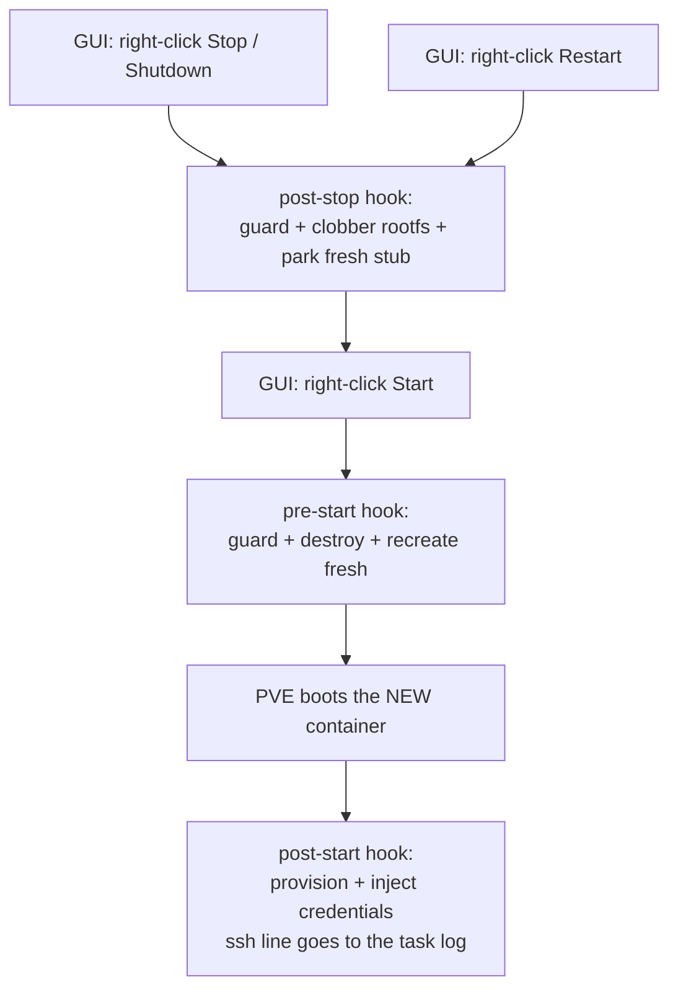

# mistral-sandbox

A single-use, auto-rebuild Linux container (LXC) sandbox for Proxmox VE,
provisioned on every build with the current
[Mistral Vibe CLI](https://docs.mistral.ai/vibe/code/cli/install-setup).
A contained environment for letting an AI coding agent work with full
outbound internet access — without handing it your machine.

## Design

- **Single use** — one sandbox at a time (fixed CTID); nothing persists
  between uses.
- **Auto rebuild on startup** — `up` (or a GUI Start) never resumes an old
  container: it destroys any existing one and rebuilds from the template,
  so every session starts clean.
- **Serially rebuildable** — a global `flock` serializes operations and the
  build is deterministic from the config block; rebuild #1 == rebuild #50.
- **Internet-enabled** — unrestricted outbound net: the agent can download
  any tool it needs (apt, curl, pip, uv, npm) and search or fetch the web
  whenever required (the Vibe CLI also has web search and fetch built in).
- **Mistral-tooled** — the current Vibe CLI (`mistral-vibe`) is installed
  at build time, unpinned, so each rebuild gets the latest iteration.
- **Credential store** — a host-side key file is re-injected into every
  rebuild; the key is created and revocable at chat.mistral.ai
  (Code > Vibe CLI) and never lives in this repository.
- **SSH-kept** — a dedicated sandbox keypair is permanently retained on the
  host (default `/root/.vibe-sandbox-ssh`), generated automatically on the
  first `up`, and its public half is injected into every rebuild. The
  private key stays on the host; override with `SSH_PUBKEY` to reuse an
  existing key instead.
- **MAC-kept** — the sandbox's MAC address is generated once and retained
  on the host (default `/root/.vibe-sandbox.mac`), then pinned on every
  rebuild — PVE would otherwise mint a fresh random MAC each time, silently
  breaking DHCP reservations. Fix the sandbox IP by reserving it on your
  DHCP server for that MAC: the reservation then holds for every future
  rebuild. Override with `CT_MAC`.
- **GUI-trapped** — the Proxmox GUI drives the lifecycle: right-click
  Start = fresh rebuild + provisioning; Stop = disk clobber + parked stub;
  Restart = fresh rebuild. Implemented with a `pct` hookscript, whose shim
  is auto-deployed on every run. `HOOK=off` disables it.
- **Clobbered** — on stop, the rootfs is discarded (`CLOBBER=discard`,
  instant on SSD) or zero-filled (`CLOBBER=zero`, overwrite-grade) and the
  CT is replaced by a pristine, unprovisioned stopped stub: the GUI keeps
  a Start-able object while the stopped sandbox holds nothing from the
  previous session. `CLOBBER=off` skips the wipe.
- **Ownership-guarded** — every destroy or clobber first verifies the CT
  carries this script's ownership tag (`vibe-sandbox`) and the sandbox
  hostname. A same-ID collision — another system squatting on the CTID,
  by design or by operator error — aborts loudly instead of being
  destroyed. In the GUI, a refused check aborts the task: it fails closed.
- **Work-guarded** — no teardown silently incinerates unextracted work:
  before `up`, `down`, `purge`, or a GUI Stop/Restart kills a running
  sandbox, it is scanned for git repos with uncommitted changes,
  meaningful new files, or commits not on any remote. Findings abort
  the teardown (interactive default-No confirm; fail-closed when
  unattended, e.g. cron) unless `FORCE=1`. An approved teardown is
  rescue-archived first: the whole CT is dumped with `vzdump` to backup
  storage (`RESCUE_STORAGE`: a comma-separated preference list checked
  in order; `auto` = the first storage with backup content in
  `/etc/pve/storage.cfg`; default `unraid-lvm,auto`),
  keeping the last `RESCUE_KEEP` archives, so an approved destruction is
  still recoverable; a failed archive aborts with nothing destroyed.
  `RESCUE=0` skips the archive.
- **Self-updating** — the script is installed by hand, so local copies
  drift; build paths (`up`, GUI Start) sha256-check against the copy on
  `main`, auto-install the current version (previous copy kept beside
  the script), and re-run once. `AUTO_UPDATE=off` disables; the `update`
  subcommand does it on demand.
- **Connector-hardened** — every rebuild injects a hardened
  `/root/.vibe/config.toml` (mode `400`) disabling Vibe connectors
  (`VIBE_CONNECTORS=off`), MCP servers (`VIBE_MCP=off`), and
  auto-approve/YOLO execution (`VIBE_AUTO_APPROVE=off`) by default.
  `VIBE_HARDEN=off` skips config injection.
- **Egress-firewalled** — with `FIREWALL=on` (default), `net0` carries
  `firewall=1` and the host writes `/etc/pve/firewall/<CTID>.fw` outside
  container root control. Default `EGRESS_POLICY=lan-block` permits
  inbound SSH and outbound DHCP/DNS/internet while dropping outbound
  RFC1918 LAN, link-local/metadata, CGNAT, and IPv6 ULA traffic;
  `EGRESS_POLICY=strict` drops all other outbound traffic except
  `EGRESS_ALLOW` destinations; `EGRESS_POLICY=off` disables it.

## Requirements

- Proxmox VE 8.x; run on the host as root (uses `pct` / `pveam` / `pvesm`).
- A bridge with DHCP (default `vmbr0`).
- A storage pool for the rootfs (default `local-lvm`).
- Internet access from the host (the build downloads the container
  template, the toolchain, and the Vibe CLI).
- No SSH key needed in advance: the script generates a dedicated keypair on
  the first `up` and retains it at `/root/.vibe-sandbox-ssh`.

## Quick start (step by step)

Every command below runs in a root shell on the Proxmox VE host itself.
Open the host console or SSH into it, then:

```bash
sudo -i
```

### 1. Download the script to the host

```bash
curl -fsSL https://raw.githubusercontent.com/itsfja/mistral-sandbox/main/vibe-sandbox.sh -o /root/vibe-sandbox.sh
chmod +x /root/vibe-sandbox.sh
```

Check it landed and works — this prints the built-in help, nothing else:

```bash
ls -l /root/vibe-sandbox.sh    # must show -rwx... (an x in the permissions)
/root/vibe-sandbox.sh          # prints usage; no side effects
```

Prefer git? `git clone https://github.com/itsfja/mistral-sandbox.git`
and use the script from the checkout; every later step is identical.

The script also keeps itself current: every `up` (and every GUI Start)
sha256-checks against the copy on `main` and self-updates if the local
one is stale — the previous copy is kept at
`/root/vibe-sandbox.sh.bak`. `AUTO_UPDATE=off` disables it; see
[Self-update](#self-update).

### 2. Add your Mistral API key (one time)

Create a key at chat.mistral.ai (Code > Vibe CLI), then store it on the
host — replacing `paste_your_key_here` with the real key:

```bash
printf 'MISTRAL_API_KEY=paste_your_key_here\n' > /root/.vibe-sandbox.env
chmod 600 /root/.vibe-sandbox.env
```

Check it — exactly one line starting with `MISTRAL_API_KEY=`:

```bash
cat /root/.vibe-sandbox.env
```

Never paste the real key anywhere except this file — not into issues, PRs,
chats, or screenshots. If you skip this step entirely, builds still work,
but the first `vibe` launch inside the sandbox will fall back to an
interactive sign-in.

Make it a **Vibe** key, not a Studio key: both authenticate against
the API, but only a Vibe key carries the Vibe Code entitlement — a
Studio key leaves every prompt inside the sandbox failing with
`Invalid API key` (see Troubleshooting). Note that only one Vibe key
exists at a time: creating a new one revokes the previous Vibe key
wherever it was used, so keep a separate Studio key for non-Vibe
projects.

### 3. Check three host settings (two minutes)

```bash
pct list       # CT 1042 must not already exist; if it does, pick another: CTID=1043
pvesm status   # find your rootfs storage name; default expected: local-lvm
ip -br link show type bridge    # list the bridges that exist; default expected: vmbr0
```

Then confirm the bridge actually carries working networking. Best signal:
what your existing CTs already use (each line shows
`<file>: net0: ...bridge=<name>...`):

```bash
grep -H net0 /etc/pve/lxc/*.conf 2>/dev/null || echo "no existing CTs — use the DHCP probe below"
```

That check only means something if you already have CTs. On a fresh node
with none, or if the grep printed nothing:

- Bridges are rebuilt from `/etc/network/interfaces` at boot, so check
  what PVE is configured to create there:
  `grep -E '^iface|bridge-ports' /etc/network/interfaces`.
- Probe the candidate bridge for a DHCP server without creating any CT:

  ```bash
  timeout 60 dhclient -1 -d -sf /bin/true -lf /dev/null -pf /tmp/dhcptest.pid vmbr0 \
    && echo "DHCP reachable on vmbr0" || echo "no DHCP answer on vmbr0"
  ```

  One real DHCPDISCOVER is sent (a DHCP server may briefly hold the lease
  it offers), but the offered address is never applied (`-sf /bin/true`)
  and the probe exits on its own. If `dhclient` is not installed:
  `apt install isc-dhcp-client`. A timeout here predicts the
  `no IP` build failure later — fix DHCP on that network first.
- Or skip the probe entirely: run `up` and treat its
  `container started but no IP` error as the check. That failure is
  benign — remove the half-built CT with `purge`, fix the bridge/DHCP,
  and run `up` again.

If your storage or network bridge differ from the defaults, pass them on
the command line (with every command you run):

```bash
STORAGE=my-pool BRIDGE=vmbr1 /root/vibe-sandbox.sh up
```

### 4. Build the sandbox

```bash
/root/vibe-sandbox.sh up
```

The first run downloads the container template, generates the retained
SSH keypair, provisions the toolchain and Vibe CLI, and auto-deploys the
GUI hookscript shim — expect a few minutes. It ends with `sandbox ready.`
followed by the ssh line. If you do not see both lines, it failed: read the
message above them and check Troubleshooting below.

### 5. Get inside

```bash
ssh -i /root/.vibe-sandbox-ssh root@$(/root/vibe-sandbox.sh ip)
```

The IP is the one `up` printed; `/root/vibe-sandbox.sh ip` shows it again
any time. Once inside, confirm the tooling:

```bash
vibe --version    # the CLI is installed
vibe              # start a session; /whoami shows which credentials are in use
```

If a session starts but every prompt comes back `Invalid API key`,
the key itself is usually fine — check `/whoami` first (plan, key
scope, credential source); if the preset model is not entitled to the
key, switch presets with `/model`. The `Invalid API key` entry in
Troubleshooting covers the full story.

Or work from your desktop instead of the host: see
[From your desktop (export)](#from-your-desktop-export) below. For a full
editor GUI over the sandbox, see
[Coding from the sandbox in VS Code (Remote-SSH)](#coding-from-the-sandbox-in-vs-code-remote-ssh).

Other doors in and out:

- `/root/vibe-sandbox.sh shell` — run on the **host**, it drops into a
  root shell in the CT (`pct enter`, no password).
- The Proxmox GUI **console** is the one door that never opens: the
  sandbox has no root password (root ships locked, the script never
  sets one, and root SSH is key-only), so the console login prompt
  refuses everything, by design. Use ssh or `shell`.

### 6. When you are done

```bash
/root/vibe-sandbox.sh down
```

The disk is clobbered and the sandbox is parked as a fresh, stopped stub:
nothing from your session is recoverable from it. Your API key store and
SSH keypair stay on the host. The next session is either `up` again, or
just right-click Start on the stub in the Proxmox GUI. To remove the CT
from the tree entirely, use `purge` instead.

## From your desktop (export)

Only the build (`up`) and teardown (`down`) have to run on the PVE
console; your day-to-day ssh sessions can run from your desktop. After
`up`:

```bash
/root/vibe-sandbox.sh export
```

writes a desktop bundle to `/root/vibe-sandbox-export` (overridable:
`EXPORT_DIR`): a copy of the sandbox keypair, an `ssh-config` snippet
(`ssh vibe-sandbox`), and a README.txt with per-OS instructions
(Linux/macOS, Windows built-in OpenSSH, and a PuTTY `.ppk` conversion).
It prints the `scp` command to fetch the tarball from your desktop
(host SSH must be reachable from your LAN; on multi-homed hosts the
printed address is the first from `hostname -I` — override it with
`HOST_IP=<reachable-address>`), then:

```text
mkdir -p ~/.ssh && chmod 700 ~/.ssh          # Linux/macOS
cp vibe-sandbox vibe-sandbox.pub ~/.ssh/
cat ssh-config >> ~/.ssh/config
ssh vibe-sandbox
```

### Fix the IP on your DHCP server (recommended)

The sandbox gets its address over DHCP, so the IP can change on every
rebuild — but the **MAC address is permanent**: the script retains it on
the host (default `/root/.vibe-sandbox.mac`, like the keypair) and pins it
on every rebuild. So fix the IP once on whatever hands out addresses
(router, pfSense/OPNsense, Pi-hole, Windows DHCP...): create a DHCP
reservation for the sandbox MAC, and the same IP comes back for every
future rebuild — `ssh vibe-sandbox` then works forever without touching
your ssh config again.

The retained MAC is **locally administered** (`02:...`, the
locally-administered bit set — deliberate, so it never squats on a
real vendor OUI). Some routers flag such MACs with a
"private MAC"/"unknown manufacturer" warning on the device; that is
cosmetic — the MAC is stable and pinned on every rebuild, so the
reservation holds. If your router genuinely objects, pin a
universally-administered MAC instead: overwrite the retained store
(`printf 'xx:xx:xx:xx:xx:xx\n' > /root/.vibe-sandbox.mac`, durable —
every later command uses it), or pass `CT_MAC=xx:xx:xx:xx:xx:xx` per
command.

Find the MAC with any of:

```bash
pct config 1042 | grep net0        # hwaddr=... on the host
cat /root/.vibe-sandbox.mac        # the retained MAC store
```

`export` also prints it and lists it in the bundle README.txt.

Notes:

- **The keypair is permanent**: one export unlocks every future rebuild.
  Only the IP embedded in `ssh-config` can go stale after each rebuild —
  re-run `export`, or avoid it entirely with the DHCP reservation above
  (the MAC it binds is retained across rebuilds, so the reservation holds
  forever).
- **Rebuilds mint fresh SSH host keys**: every `up` creates new host
  keys, so strict host-key checking would block the second rebuild's
  connect. The bundled `ssh-config` snippet pins
  `StrictHostKeyChecking no` for the sandbox Host only (nothing else
  shares the alias); with a hand-rolled config, expect `REMOTE HOST
  IDENTIFICATION HAS CHANGED` after each rebuild, and clear it with
  `ssh-keygen -R <ip>`.
- `export` requires a running sandbox (it embeds the current IP) and the
  managed keypair; with an `SSH_PUBKEY` override, export your own key
  yourself — the script will not copy keys it does not manage.
- Honest cost: the private key then also exists in the host's export dir
  and on your desktop. That is the point of the feature, but it means the
  key no longer lives only on the host — delete the export dir after
  fetching the tarball (the bundle README says how).

## Coding from the sandbox in VS Code (Remote-SSH)

The exported `ssh vibe-sandbox` alias (see
[From your desktop (export)](#from-your-desktop-export)) also works as a
VS Code remote: the editor UI runs on your desktop, the
[Remote - SSH](https://marketplace.visualstudio.com/items?itemName=ms-vscode-remote.remote-ssh)
extension connects through the same pinned ssh config (rebuild host-key
rotation is already covered by the pin), and the
[Mistral Vibe extension](https://docs.mistral.ai/vibe/code/vs-code-extension/install-authenticate)
runs its agent inside the container over the same credentials as the CLI.
Nothing new is provisioned by this script and nothing persists:
`vscode-server` and the extension install live inside the CT and die with
every rebuild, by design.

Setup (desktop side, once):

1. Set `remote.autoForwardPorts` to `false` in your VS Code settings
   **before the first connect**. By default, any port a process inside
   the sandbox listens on is forwarded to `localhost` on the desktop,
   where browsers sometimes hand out implicit trust to localhost
   listeners; turning it off keeps sandboxed processes off your desktop
   loopback.
2. **Remote-SSH: Connect to Host**, pick `vibe-sandbox`. The first
   connect installs `vscode-server` into the CT (a minute or two: it
   downloads itself, version-matched to your desktop VS Code).
3. In the Extensions view, install **Mistral Vibe** with
   **Install in SSH: vibe-sandbox**. It bundles its own agent (no CLI
   wiring needed) and reads the credentials the build already injected
   at `/root/.vibe/.env`: it comes up authenticated with no prompt, and
   shares sessions and the Vibe Code budget with the CLI.
4. Once, stop reinstalling it by hand: add the extension's marketplace
   ID to Remote-SSH's `remote.SSH.defaultExtensions` ("always installed
   on any SSH host"), in the same desktop settings.json as step 1:

   ```json
   "remote.SSH.defaultExtensions": ["mistralai.mistral-vibe-code"]
   ```

   From then on the extension installs itself into the sandbox on
   every connect, and the per-rebuild **Install in SSH** click below
   disappears. (Remote-SSH fetches the Marketplace version; the `code`
   CLI itself still has no switch for the remote slot.)
5. Optionally, preempt the one-time "select the platform of the remote
   host" picker on a fresh desktop: pin the alias platform in the same
   settings.json (or just answer the picker once; Remote-SSH saves the
   answer per alias, so rebuilds never re-ask):

   ```json
   "remote.SSH.remotePlatform": { "vibe-sandbox": "linux" }
   ```

### One-command reconnect (desktop scripts)

The ssh side of the reconnect is scriptable. `vscode-connect.sh`
(Linux/macOS) and `vscode-connect.ps1` (Windows) sit beside this script in
the repo: they refresh the desktop ssh entry for the sandbox and open
VS Code straight into the remote over the `code` CLI. (Under the hood
they run `code --folder-uri vscode-remote://ssh-remote+vibe-sandbox/<folder>`,
which also works on its own once your ssh config block is current.)

```bash
# Linux/macOS; PVE_HOST must be ssh-reachable from the desktop
PVE_HOST=root@192.168.3.188 bash vscode-connect.sh              # opens /root
PVE_HOST=root@192.168.3.188 bash vscode-connect.sh /root/work   # another folder
```

```powershell
# Windows (PowerShell; ssh/scp are built in from Windows 10)
$env:PVE_HOST = 'root@192.168.3.188'
.\vscode-connect.ps1
```

The `$env:` and command-line-prefix forms above are transient: they
cover that window or that single run only. To stop ever setting
`PVE_HOST`, make it a persistent user environment variable, one time
from any PowerShell:

```powershell
[Environment]::SetEnvironmentVariable('PVE_HOST', 'root@192.168.3.188', 'User')
```

then **open a new window** (already-open windows never see the change);
new processes inherit it automatically. On Linux/macOS the equivalent is
a line `export PVE_HOST=root@192.168.3.188` in `~/.bashrc`
(or `~/.zshrc`). The not-set error in both scripts prints these
permanent forms when it fires.

What a run does:

- Fast path: tries `ssh vibe-sandbox` as-is first; if it works (say, a
  DHCP reservation is pinning the IP), the Proxmox host is never even
  contacted.
- Stale path (a rebuild changed the IP): fetches the current IP from
  `$PVE_HOST` (`vibe-sandbox.sh ip`), rewrites **only** its marked
  `# BEGIN/END vibe-sandbox` block in your ssh config (a legacy
  unmarked `Host vibe-sandbox` block from the manual export flow is
  replaced; every other host entry is untouched), fetches the permanent
  private key once if it is missing, waits for ssh to come good, then
  opens `code --folder-uri vscode-remote://ssh-remote+vibe-sandbox/root`.
- The keypair is permanent, so after the first run nothing is fetched
  again: only the `HostName` line ever changes between rebuilds.

Overrides (env vars, defaults in the script headers): `PVE_SCRIPT`,
`PVE_KEY`, `SSH_ALIAS`. The account at `PVE_HOST` must be able to read
the managed sandbox key on the host (root by default). The extension
side is pushable too: `remote.SSH.defaultExtensions` (desktop setup,
step 4) makes every connect install `mistralai.mistral-vibe-code` into
the sandbox; without it, the `code` CLI has no switch for the remote
extension host slot and the Extensions view stays the only door.

Per-rebuild tax: every `up`, `down`, or GUI Stop wipes the CT, and
`vscode-server` and the extension install go with it. Reconnecting after
a rebuild reinstalls the server, and the extension either reinstalls
itself on connect (when listed in `remote.SSH.defaultExtensions`) or
needs one **Install in SSH** click. This is dev-tooling churn, not lost
work: the lifecycle, the work guard, and the rescue archive are
unaffected.

Tooling note: do not preinstall `vscode-server` in
[`provision.sh`](#hooks); it self-installs on connect, version-matched to
your desktop editor, and base provisioning stays what it is. The same
goes for session-acquired tooling in general (say, a test runner pulled
in by a repo you were testing): it is not part of the base image and
does not survive a rebuild. Anything every session genuinely needs goes
in `provision.sh` (toolchains, repo clones), not in the base image.

Security habits, restated for the remote path:

- The ingress is unchanged: ssh from the desktop is the only door, and
  nothing here adds a LAN listener. Never expose CT services to the LAN
  to work around friction.
- Keep the remote workspace **untrusted** unless a task truly needs
  trust, and decline extension installs that workspace content
  recommends.
- Read shell-command approvals before allowing them; never adopt an
  always-allow option if the extension offers one.
- `down` when you are done for the day: along with everything else, it
  closes the remote session's foothold. Never leave a connected, idle
  VS Code remote session running overnight against a live sandbox.

## GUI-driven lifecycle (Proxmox right-click)

With `HOOK=on` (the default), the sandbox CT carries a `pct` hookscript, so
the Proxmox GUI becomes the front end:



| GUI action | What actually happens |
| --- | --- |
| Start | fresh rebuild from template, then provisioning; the Start task stays busy until provisioning finishes — open its log for the `ssh -i ...` line |
| Stop / Shutdown | rootfs clobbered (`CLOBBER`), CT replaced by a pristine stopped stub; the GUI keeps a Start-able object holding nothing from the session |
| Restart | stop phases, then start phases: a fresh rebuild |
| Snapshot / Clone / Migrate / Backup / Console | **not trappable** (no hook phase) — harmless, since the next Start purges everything, but they cannot be blocked per-CT |

CLI and hooks coexist: a hook phase fires from *inside* the `pct` call
that triggered it. When `up` or `down` triggers one (`up` starts the CT,
`down` stops it), that CLI operation already holds the serial lock and
does the phase's work itself — the hook passes through with a one-line
notice. When the GUI triggers the phase, the hook takes the lock and
does the work. A hook phase therefore never aborts a CLI build with
"another operation is running"; it only ever guards the CT.

Honest caveats:

- **Test on your PVE build first.** The pre-start hook recreates the CT
  while PVE is mid-Start on the same vmid. It works because the recreated
  config and disk volid are identical (same vmid, same storage), but it is
  the piece most sensitive to PVE updates.
- **Clobber levels.** `discard` is instant on SSDs and defeats casual and
  software-level recovery, but relies on the drive honoring TRIM — it is
  not guaranteed against chip-level forensics. `zero` is overwrite-grade
  at the cost of a few minutes per stop. Neither protects the *host's* key
  store: if physical theft is in your threat model, encrypt the PVE root
  VG with LUKS, and rely on the sandbox's dedicated, instantly revocable
  API key.

## Ownership guard

The script destroys and wipes a fixed CTID on every rebuild, so it refuses
to touch any CT it cannot prove it owns. Ownership = the CT carries both
the sandbox hostname (`vibe-sandbox`) and the ownership tag
(`vibe-sandbox`, both overridable) on its config:

- **Created by this script** — the tag is set automatically at `pct create`;
  nothing to do.
- **Legacy sandbox from an older script version** (no tag) — recognized and
  auto-tagged, but only if it also carries the managed hookscript.
- **Anything else at that ID** — your wordpress CT, someone's test box, a
  mis-set `CTID` — every `up`, `down`, `purge`, and GUI hook aborts with
  `refusing to touch CT <id>` and states what to do: move the CT or pick
  another `CTID`. Tag it manually only if you are certain it is an old
  sandbox: `pct set <id> --tags vibe-sandbox`.

The guard fails closed: in the GUI, a refused Start or Stop aborts the task
with the refusal message in the task log rather than touching the CT.

## Connector & egress hardening

Isolating a Linux container only contains **compute and local filesystem
state** — it does **not** contain information as long as outbound
connectors are enabled or the container can probe internal network
services. Even inside an unprivileged LXC container, an agent can
introspect runtime, hostname, kernel, or hypervisor details and relay
them outward through an enabled write-capable connector (for example, a
Slack message, Gmail draft, Notion page, or GitHub issue).

The isolation boundary therefore spans **three layers**:

### 1. In-container Vibe configuration (automated on every rebuild)

During provisioning (`up` and GUI Start), `vibe-sandbox.sh` injects
`/root/.vibe/config.toml` (`chmod 400`, `root:root`) with default-deny
settings:

```toml
enable_connectors = false
enable_mcp = false
enable_auto_approve = false
```

Override any individual setting on build when a task explicitly needs
it, or disable injection with `VIBE_HARDEN=off`:

```bash
VIBE_MCP=on /root/vibe-sandbox.sh up
VIBE_CONNECTORS=on VIBE_MCP=on /root/vibe-sandbox.sh up
```

Honest boundary caveat: the sandbox session runs as `root` inside the
CT, so `/root/.vibe/config.toml` is a **default-deny guardrail** against
implicit connector invocation and auto-approved execution — not a
tamper-proof MAC boundary against a malicious root process inside the
container. Layers 2 and 3 enforce the hard boundary outside the CT.

### 2. Host-enforced Proxmox LXC firewall (outside container control)

Because the Proxmox firewall runs on the hypervisor bridge (`veth`), a
root process inside the sandbox cannot flush or disable it. With
`FIREWALL=on` (default), `vibe-sandbox.sh` attaches `firewall=1` to
`net0` and atomically writes `/etc/pve/firewall/<CTID>.fw` **before**
the container boots:

| `EGRESS_POLICY` | Inbound | Outbound |
| --- | --- | --- |
| `lan-block` *(default)* | `DROP` except SSH (`TCP 22`) | Allows DHCP (`UDP 67–68`), DNS (`UDP/TCP 53`), explicit `EGRESS_ALLOW`, and general internet; **DROPs** outbound RFC1918 LAN (`10.0.0.0/8`, `172.16.0.0/12`, `192.168.0.0/16`), link-local/metadata (`169.254.0.0/16`), CGNAT (`100.64.0.0/10`), and IPv6 ULA/link-local (`fc00::/7`, `fe80::/10`) |
| `strict` | `DROP` except SSH (`TCP 22`) | `policy_out: DROP`; allows **only** DHCP, DNS, and explicit comma-separated CIDRs/IPs in `EGRESS_ALLOW` |
| `off` | Unmanaged | Unmanaged (`firewall=1` omitted; managed `.fw` removed) |

Examples:

```bash
# Default: block LAN/host/metadata lateral movement, allow internet + LAN DNS
/root/vibe-sandbox.sh up

# Allow one internal LAN Git server while keeping the rest of the LAN blocked
EGRESS_ALLOW=192.168.3.50/32 /root/vibe-sandbox.sh up

# Strict egress: drop all outbound except an explicit proxy or IP allowlist
EGRESS_POLICY=strict EGRESS_ALLOW=192.168.3.10/32 /root/vibe-sandbox.sh up
```

**Proxmox Datacenter firewall prerequisite:** Proxmox ignores per-CT
`.fw` rules unless the Datacenter firewall is enabled in
`/etc/pve/firewall/cluster.fw`. The script intentionally never enables
the cluster firewall automatically (doing so without host rules could
lock you out of SSH or the PVE web UI); instead, `up` and `status` warn
you when it is off. To enable it safely:

1. In the Proxmox GUI, verify host management access is permitted (Proxmox
   allows management subnet access to port `8006` and `22` by default, or
   add explicit Datacenter `IN ACCEPT` rules for your admin LAN on ports
   `22` and `8006` first).
2. Enable **Datacenter > Firewall > Options > Firewall: Yes**.
3. Run `/root/vibe-sandbox.sh status` and confirm it reports
   `firewall: lan-block (enforced)`.

### 3. Mistral Vibe Work & account-level connectors (manual checklist)

Connectors attached to your Mistral account (Slack, Gmail, Notion,
GitHub App, Linear, Atlassian, Outlook, Box, SharePoint, Stripe) live
outside the container and host, so this script cannot toggle them. When
running sandboxed sessions alongside Vibe Work:

1. **Default-deny connectors per chat.** Disable all connectors inside
   the sandbox chat (**`+` > Tools**, toggle connectors off) while
   keeping them connected at the account level for normal work.
2. **Never pre-authorize connector functions ("Always allow").** Require
   explicit per-action approval for every outbound call so writes cannot
   fire silently.
3. **Restrict write-capable connectors.** Prefer read-only connector
   functions, or keep write-capable connectors disabled entirely for
   sandboxed runs.
4. **Strip ambient context channels.** Do not attach scheduled tasks,
   shared projects, libraries, or knowledge files that carry host, LAN,
   or hypervisor details into a sandbox session.

References:
- [Mistral Vibe Work Connectors](https://docs.mistral.ai/vibe/work/connectors)
- [Mistral Vibe Work Safety and Approvals](https://docs.mistral.ai/vibe/work/safety-and-approvals)

## Troubleshooting

- `no debian-12 template found; set TEMPLATE manually` — the host's
  template list is empty. Run `pveam update`, then find the name with
  `pveam available --section system` and download it with
  `pveam download local <name>`; or set `TEMPLATE=local:vztmpl/<name>`.
- `container started but no IP (check vmbr0/DHCP)` — the bridge has no
  DHCP server handing out addresses. Fix DHCP on that network, or create
  a bridge that has one, and pass `BRIDGE=<name>`. The step-3 DHCP probe
  can confirm this before you build again.
- `must run as root` or `permission denied` — you are not root. `sudo -i`
  first; every command in Quick start assumes root.
- `curl` failed to download the script — check the host's internet:
  `curl -I https://github.com` should return HTTP 200.
- `another vibe-sandbox operation is running` — a build is in progress;
  the script refuses to run two at a time by design. Wait for it to
  finish (or check `ps aux | grep vibe-sandbox`).
- `hookscript error ... on pre-start` at the end of a CLI `up`, right
  after the CT is created — a script from before the hook-lock fix:
  the pre-start hook demanded the serial lock while `up` itself held
  it, aborting the very start it was part of. Update the script
  (`update` subcommand, or the step-1 `curl` one-liner) and re-run
  `up`: the half-built CT is destroyed first and the rebuild proceeds.
- `up` aborts right after the Vibe installer's `[ERROR] Your PATH does
  not include ...` (no `sandbox ready.` line) — a script from before
  the provisioning PATH fix: provisioning died when the installer
  exited nonzero over the missing `~/.local/bin` PATH, so the CT was
  left WITHOUT credentials (`/root/.vibe/.env` never injected).
  Update the script and re-run `up` for a clean rebuild; the
  half-provisioned CT is destroyed first.
- `clobber: blkdiscard failed` — your rootfs sits on rotational storage;
  use `CLOBBER=zero` for overwrite-grade wiping.
- `refusing to touch CT <id>: it is not this script's sandbox` — the
  ownership guard fired: something that is not a tagged, sandbox-hostnamed
  CT sits at that ID. Move it or set `CTID` to a free ID; only if you are
  certain it is an old sandbox, tag it manually:
  `pct set <id> --tags vibe-sandbox`.
- `400 Parameter verification failed. ostemplate: value may only be 255
  characters long` — an older script version captured the template
  download's progress log into the template name on the first run (before
  the template was cached). Update the script (the step-1 `curl` one-liner
  again) and re-run `up`: the downloaded template is kept, so the retry
  skips the download and builds normally.
- `ssh vibe-sandbox` connects to nothing after a rebuild — the IP in your
  ssh config went stale (DHCP). Re-run `export` on the host and re-fetch,
  or edit the `HostName` line in your ssh config; the key itself is still
  valid, so only the IP needs changing. To make it permanent, set a DHCP
  reservation for the sandbox MAC (retained across rebuilds): see
  [Fix the IP on your DHCP server](#fix-the-ip-on-your-dhcp-server-recommended).
- GUI Start finishes but no ssh line in the task log — the post-start
  hook found no IP or provisioning failed; read the task log output
  above it, and the same checks as the `no IP` case apply.
- `self-check: could not fetch/validate ...` (warning, build continues) —
  the self-update check could not reach `RAW_URL` or the fetched file
  failed `bash -n`; the build proceeds with the current script.
  Harmless on an offline host; otherwise check `RAW_URL`.
- GUI console / `pct console` refuses every login (`Login incorrect`) —
  by design: the sandbox has no root password (root ships locked; the
  script never sets one) and root SSH is key-only. Use
  `ssh -i /root/.vibe-sandbox-ssh root@<ip>` (note the leading dot), or
  run `/root/vibe-sandbox.sh shell` on the host (`pct enter`, no
  password).
- `ssh` says `Identity file ... not accessible` or the shell says
  `vibe-sandbox.sh: command not found` — the key lives at
  `/root/.vibe-sandbox-ssh` (leading dot) and the script is not on
  PATH: use full paths —
  `ssh -i /root/.vibe-sandbox-ssh root@$(/root/vibe-sandbox.sh ip)`.
- Router flags the sandbox device with a "private MAC" warning — the
  retained MAC is locally administered (`02:...`) by design; stable
  across rebuilds, so DHCP reservations hold. To silence it, pin a
  universally-administered MAC:
  `printf 'xx:xx:xx:xx:xx:xx\n' > /root/.vibe-sandbox.mac` (or
  `CT_MAC=...` per command).
- `ssh vibe-sandbox` from the desktop fails after a rebuild with
  `REMOTE HOST IDENTIFICATION HAS CHANGED` — expected: every rebuild
  mints a fresh SSH host key (the sandbox's real identity is the
  permanent keypair). The bundled ssh-config pins
  `StrictHostKeyChecking no` for this one Host, so this only bites
  hand-rolled configs; recover with `ssh-keygen -R <ip>` and reconnect.
- `export`'s scp line points at an unreachable address — the scp hint
  defaults to the first address from `hostname -I`; on multi-homed
  hosts that may not be your LAN address. Rerun with
  `HOST_IP=<reachable-address> /root/vibe-sandbox.sh export`.
- `ssh -i /root/.vibe-sandbox-ssh root@<ip>` on the **host** fails
  after a rebuild with `REMOTE HOST IDENTIFICATION HAS CHANGED` —
  the same expected host-key rotation, host side: every rebuild mints
  a fresh host key. `up` and GUI Start purge the stale `known_hosts`
  entry for the sandbox IP automatically at build time; if you still
  hit it (connected before the purge ran, or with a pre-purge script),
  recover with `ssh-keygen -R <ip>` and reconnect.
- Every prompt inside the sandbox fails with `Invalid API key`, yet
  the key is demonstrably valid — `/whoami` authenticates and the
  Mistral console shows the key active — and `/whoami` reports
  `Plan: Free` on a paid account: the key is a **Studio** key. Studio
  keys authenticate but carry no Vibe Code entitlement, so model
  calls come back `tier_not_allowed`, which the CLI misleadingly
  surfaces as "Invalid API key" plus a Free plan. Fix: create a
  **Vibe** key at chat.mistral.ai (Code > Vibe CLI) — only one Vibe
  key exists at a time, and creating it revokes the previous one, so
  keep a separate Studio key for non-Vibe projects — then update the
  host store (`printf 'MISTRAL_API_KEY=<new-key>\n' > /root/.vibe-sandbox.env`)
  and run `up` again. `/whoami` should then show the paid plan and
  `Key scope: vibe`.
- The Mistral Vibe extension (or `vscode-server`) is gone from the SSH
  remote after a rebuild: expected, both live inside the CT and are wiped
  with it. Reconnect (the server reinstalls itself on connect, a minute
  or two), then **Install in SSH: vibe-sandbox** for the extension again
  (or list it in `remote.SSH.defaultExtensions` so the reinstall happens
  on connect instead); auth stays zero-touch because `/root/.vibe/.env`
  is re-injected on every build. See
  [Coding from the sandbox in VS Code (Remote-SSH)](#coding-from-the-sandbox-in-vs-code-remote-ssh).
- `up`, `down`, `purge`, or a GUI Stop/Restart aborts with the **work
  guard**: the running sandbox holds git repos with uncommitted changes,
  new files, or commits not on any remote, and tearing it down would
  permanently lose them. Push or extract the work, then re-run;
  `FORCE=1 <command>` proceeds without prompting (a rescue archive is
  still taken first when work is found). On approval, the whole CT is
  archived with `vzdump` to the first usable entry of `RESCUE_STORAGE`
  (a comma-separated preference list, checked in order; default
  `unraid-lvm,auto`; an entry without backup content in
  `/etc/pve/storage.cfg` is skipped); only the last
  `RESCUE_KEEP` archives are kept. If the archive fails, nothing is
  destroyed. Recover one with `pct restore 1042 <archive>`, or extract
  files straight out of the tar. GUI
  refusals appear in the PVE task log (the hookscript cannot prompt);
  an unattended cron rebuild fails closed the same way, naming the
  repos in its log.
- `warning: Proxmox Datacenter firewall is disabled ... per-CT egress rules ... are NOT enforced yet` —
  the script wrote `/etc/pve/firewall/<CTID>.fw` and attached
  `firewall=1` on `net0`, but Proxmox does not enforce per-CT rules
  until **Datacenter > Firewall > Options > Firewall** is set to `Yes`.
  Ensure management access to ports `22` and `8006` is allowed before
  turning it on, or pass `FIREWALL=off` if you intentionally manage
  egress elsewhere.
- Container cannot reach an internal Git server, proxy, or registry on
  your LAN — expected under the default `EGRESS_POLICY=lan-block`
  (RFC1918 egress is dropped except DNS on port 53). Punch a surgical
  hole with `EGRESS_ALLOW=<ip>/32`, or use `EGRESS_POLICY=off` if you
  explicitly want unrestricted LAN reachability.
- `refusing to overwrite unmanaged firewall ruleset at /etc/pve/firewall/<CTID>.fw` —
  a pre-existing `.fw` file without this script's management marker sits
  at that CTID. Inspect and remove it if it is stale, pick another
  `CTID`, or pass `FIREWALL=off`.
- Vibe CLI blocks MCP servers, connectors, or `--yolo` / auto-approve —
  expected by default: `/root/.vibe/config.toml` sets
  `enable_connectors = false`, `enable_mcp = false`, and
  `enable_auto_approve = false`. Re-enable selectively at build time
  with `VIBE_MCP=on`, `VIBE_CONNECTORS=on`, or `VIBE_AUTO_APPROVE=on`
  (or `VIBE_HARDEN=off`).

## Subcommands

| Command | Action |
| --- | --- |
| `up` | destroy any prior sandbox, rebuild, start, provision, print ssh line |
| `down` | clobber the disk and park a fresh stopped stub (GUI Start-able) |
| `purge` | destroy completely — no stub, gone from the tree |
| `reset` | `down` then `up` — fresh rebuild mid-work |
| `status` | is the sandbox up? CTID, state, IP |
| `ip` | print the current IP (empty if not running) |
| `shell` | drop into a root shell inside the CT |
| `export` | write a desktop bundle (keypair copy + ssh-config + per-OS instructions) to `EXPORT_DIR` |
| `update` | self-update the script from `main` (previous copy kept beside it) |
| `hook` | internal — called by the PVE hookscript shim with (vmid, phase) |

## Self-update

The script is installed by hand, so local copies drift: after a merged
PR, the copy on your host keeps running the old code until you
re-download it. So the script checks itself on every build path (`up`
and GUI Start — the pre-start hook; `status`, `ip`, `shell`, and
`down` stay instant and network-free):

- **How**: sha256 of the running script vs the copy at `RAW_URL` (the
  raw GitHub copy of this file on `main`). No version numbers to bump —
  a different hash means stale.
- **Stale**: the current copy is installed (it must pass `bash -n`
  first), the previous copy is kept beside the script as
  `vibe-sandbox.sh.bak`, the swap is an atomic `mv` (a concurrently
  running instance keeps executing the old file undisturbed), and the
  script re-execs itself once — so the build that noticed the drift
  runs current code.
- **Never blocks**: if the check cannot run (host offline, GitHub down,
  timeout) or the fetched file fails `bash -n`, the script warns on
  stderr and proceeds with the current copy. A stale script never
  fails a build that would otherwise succeed.
- **Controls**: `AUTO_UPDATE=off` disables the automatic check
  entirely; `vibe-sandbox.sh update` performs the update explicitly
  (same backup and validation), regardless of `AUTO_UPDATE`.

Honest caveats:

- This is code that runs as root, fetched over HTTPS from GitHub and
  executed without further review — like the install one-liner in
  step 1, but automatic. The trust boundary is this repo's `main`
  branch: anyone who can push to it can change what runs on your host.
- Hand-edited local copies are overwritten on the next build-path run
  (your edits land in the `.bak`). Patch locally only with
  `AUTO_UPDATE=off`.

## Credential store (rotation and revocation)

Every build pushes `/root/.vibe-sandbox.env` into the fresh container as
`/root/.vibe/.env`, which the Vibe CLI loads automatically on startup.
Rotate or revoke the key from the Mistral console at any time; to rotate
locally, just edit the host file — the next rebuild picks it up. Use a
dedicated key for the sandbox so revoking it never disturbs your other
Mistral usage.

## Configuration

All overridable by environment variables: `CTID`, `CTHOST`, `CORES`,
`RAM_MB`, `SWAP_MB`, `DISK_GB`, `STORAGE`, `BRIDGE`, `TEMPLATE`,
`SSH_PUBKEY` (use an existing key instead of the managed one),
`SSH_KEY_FILE` (where the managed keypair lives), `MAC_FILE` (where the
retained MAC lives), `CT_MAC` (pin a specific MAC instead of the managed
one), `SECRETS_FILE`, `HOOK` (`on`/`off`: GUI lifecycle trapping),
`CLOBBER` (`discard`/`zero`/`off`: post-stop rootfs wipe), `SANDBOX_TAG`
(ownership tag enforced by the guard before any destroy or wipe),
`EXPORT_DIR` (where the desktop bundle is written), `HOST_IP` (the host
address export prints in its scp hint — defaults to the first address
from `hostname -I`; set it on multi-homed hosts where that address is
not reachable from your desktop),
`AUTO_UPDATE` (`on`/`off`: build-path self-check against main),
`FORCE` (`1`: proceed through the work guard without prompting; a
rescue archive is still taken first when work is found),
`RESCUE` (`1`/`0`: take the pre-teardown rescue archive; default `1`),
`RESCUE_STORAGE` (comma-separated preference list of rescue backup
storages, checked in order; `auto` = the first storage with backup
content; default `unraid-lvm,auto`), `RESCUE_KEEP` (rescue
archives of this CT to retain; default `2`), `RAW_URL` (where the
self-check fetches the current script from), `VIBE_HARDEN` (`on`/`off`:
inject hardened `/root/.vibe/config.toml`; default `on`),
`VIBE_CONNECTORS` (`off`/`on`: `enable_connectors` in injected Vibe
config; default `off`), `VIBE_MCP` (`off`/`on`: `enable_mcp` in
injected Vibe config; default `off`), `VIBE_AUTO_APPROVE` (`off`/`on`:
`enable_auto_approve` in injected Vibe config; default `off`),
`FIREWALL` (`on`/`off`: attach `firewall=1` to `net0` and manage
`/etc/pve/firewall/<CTID>.fw`; default `on`), `EGRESS_POLICY`
(`lan-block`/`strict`/`off`: host-enforced outbound firewall policy;
default `lan-block`), `EGRESS_ALLOW` (optional comma-separated IPv4/IPv6
IPs or CIDRs allowed outbound), and `FW_DIR` (Proxmox firewall config
directory; default `/etc/pve/firewall`).

## Hooks

Place a `provision.sh` beside the script to run extra setup inside each
fresh container after base provisioning (toolchains, repo clones). Keep it
deterministic to keep rebuilds identical. (Unrelated to the PVE
hookscript — this one is your per-use provisioning hook.)

## Auto-rebuild on host boot (optional)

`/etc/cron.d/vibe-sandbox`:

```cron
@root /root/vibe-sandbox.sh up >> /var/log/vibe-sandbox.log 2>&1
```

## Security notes

- No credentials are stored in this repository (see `.gitignore`); the API
  key and the sandbox SSH private key live only on the host (key store and
  `/root/.vibe-sandbox-ssh`) and inside the ephemeral container — until
  you run `export`, after which a copy of the private key also exists on
  your desktop (and in the host's export dir until you delete it).
- The container is unprivileged with nesting enabled.
- Root access to the sandbox is key-only, by construction: the template
  ships root's password locked, the script never sets one, and
  provisioning pins `PermitRootLogin prohibit-password` — so the PVE
  GUI console cannot log in and root SSH accepts only the managed
  keypair (plus `pct enter` from the host).
- Treat the sandbox like a CI job: least-privileged, revocable credentials
  only.
- Clobber protects the stopped CT's disk only. For physical-theft threat
  models, LUKS-encrypt the PVE host and keep the sandbox API key dedicated
  and instantly revocable.
- Destructive operations are ownership-guarded: the script refuses to
  destroy or wipe any CT that does not carry its tag and hostname, and
  the guard fails closed in GUI hooks.
- The isolation boundary includes **tool and connector access**, not
  just the container or hypervisor: outbound connectors are write
  channels that can exfiltrate container/host introspection even when
  local network egress is restricted. Every build disables Vibe CLI
  connectors, MCP servers, and auto-approve by default and attaches a
  host-enforced Proxmox firewall (`EGRESS_POLICY=lan-block`); disable
  account-level Vibe Work connectors per-chat as well (see
  [Connector & egress hardening](#connector--egress-hardening)).
